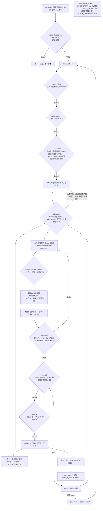

# Agent Workforce Loop 流程图（v1.2）

前置：`scaffold` → 执行侧填写并提交 config.json → 用户本地审核 → 用户本人跑 `approve.mjs config` 签名同意 → 提交同意记录 → `config-check` PASS（核对审批指纹）。



## 纯文本版

```
architect-spec → SPEC_DRAFT → spec-review(工种签署) → spec-approve(Lead) → spec-confirm(锁规则表)
  → init → dispatch(只 dev) → handoff(冻结) → qa → gate/ledger/design → evidence → accept(五层) → release(CI) → deliver
        ↑   （每个批次各走一遍；互不依赖的批次可并行）            │FAIL                    │
        └──────────── 本批 reopened ◄────────────────────────────┘     下一批 / ready ◄───┤
                        ▲                                                  │
                        └──────── user-issue ◄── 用户出 issue ◄────────────┘
REOPEN 需改 spec → spec-revise（架构师）→ SPEC_DRAFT，旧签署全部失效
```
